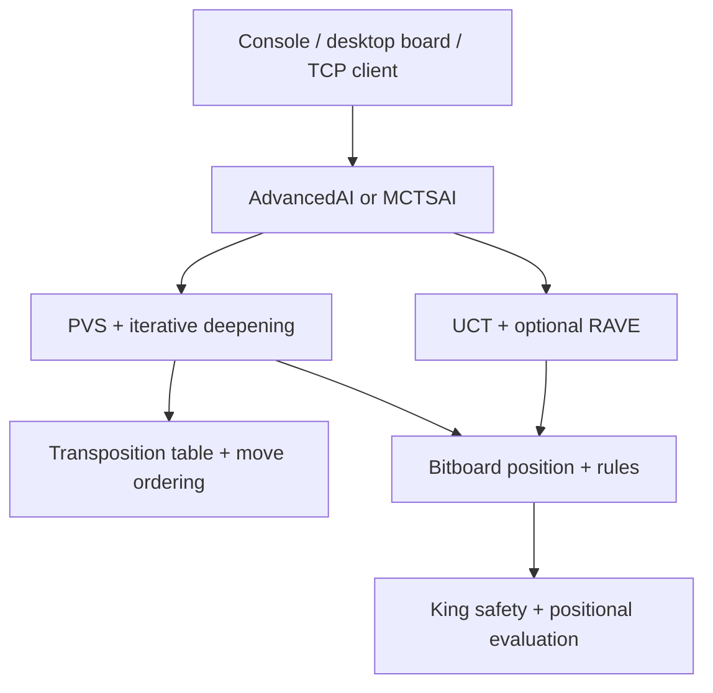

# Engine Architecture

## Board and Rules

`Board` stores three Python integers: `attackers`, `defenders`, and `king`.
Bit `row * 9 + column` identifies a square. The side to move and whether the
king has left the throne are part of position identity. Python dictionaries
resolve hash collisions using equality; a hash alone is not a unique board ID.

`moves.py` generates rook-like moves and returns a new board when applying a
move. `rules.py` handles ordinary captures, king capture, and game outcomes.
`server_rules.py` implements the gameserver's capture conventions separately.
Local play and server play therefore have explicit rules boundaries.

## Deterministic Search

Every search uses White's score perspective: White maximizes and Black
minimizes. Terminal scores favor faster wins and delayed losses.

- `minimax.py`: an unpruned reference search.
- `alpha_beta.py`: bounded search with move ordering.
- `transposition_table.py`: depth-qualified cached scores, bound flags,
  best-move hints, and a size limit.
- `alpha_beta_tt.py`: Alpha-Beta with cache and ordering state.
- `pvs.py`: first-child full-window search, followed by narrow probes and
  re-search when a probe can improve the current bound.
- `search_state.py`: killer moves indexed by ply and history rewards.
- `iterative_deepening.py`: retains the deepest completed iteration.
- `time_manager.py`: soft/hard limits and opening/midgame/endgame factors.

`AdvancedAI` composes PVS, the transposition table, ordering state, and phase
budgets. Search state is shared across iterative-deepening depths and reset
between move decisions.

## Position Evaluation

`evaluation.py` combines material, king mobility and corner distance, escape
lanes, capture threats, corner approach, and defender support. Direct bitboard
operations avoid generating full move lists for simple evaluation features.
Guarded-corner and clamp-threat penalties address a tactical weakness found
in live matches.

## Monte Carlo Search

`MCTSAI` provides the same `choose_move(board)` interface as `AdvancedAI`.
Selection uses UCT; expansion creates a child from an untried legal move;
bounded, heuristic rollouts estimate an outcome; backpropagation updates
visit counts and values from White's perspective.

With RAVE enabled, simulation moves also update side-specific AMAF statistics
for eligible sibling moves. Selection blends AMAF and direct averages with
a visit-dependent weight. Disabling RAVE provides a plain-UCT baseline.
The final root move is selected primarily by visit count.

The current implementation starts a new tree per decision and remains
single-threaded. Short rollouts and small iteration budgets can miss tactical
replies; RAVE also relies on a move-order-independence assumption that is weak
in capture-heavy Tablut positions. Evaluate strength rather than assuming
that adding RAVE improves it.

## Interfaces

`play.py` provides console play, `gui.py` provides the Tkinter board, and
`gameserver.py` connects an agent to an external TCP server. Board parsing and
serialization live in `fen.py`. Benchmark tools exercise the same engine
functions used by the agents.
